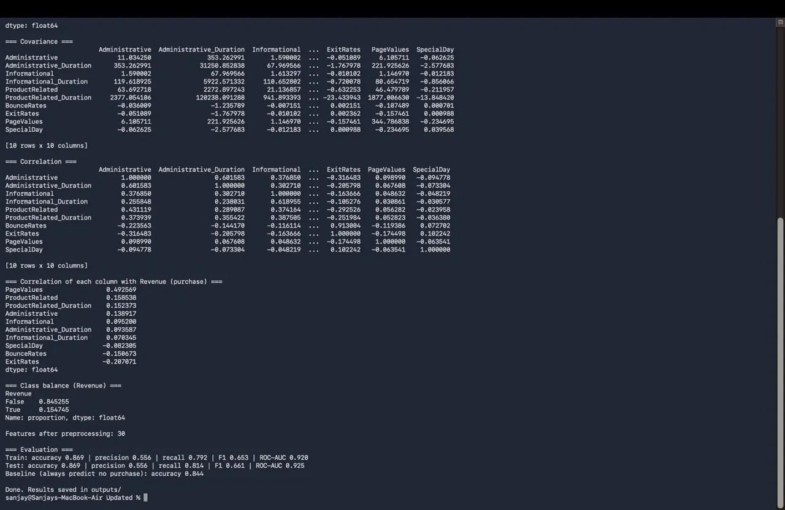

# Online Shopper Purchase Prediction

We predict whether a person visiting an online shop will buy something, using logistic regression (pandas, matplotlib, scikit-learn).

`AI101 Mini-Project` · `Team 2` · `Python 3.14`

AI101: Data Science and AI Essentials with Python, School of AI and Data Engineering, IIT Ropar

---

## Team and roles

| Member | Entry no. | GitHub handle | Role |
|---|---|---|---|
| Gangishetty Sanjay Deep | 2026AIB1035 | @SanjayButCodes | Documentation lead |
| Keshav Garg | 2026ESB1480 | @Keshav-Garg21 | Video lead |
| Pratyush Rao Elchuri | 2026MCB1556 | @pratyushh1108 | PPT lead |
| Rudra Baleshkumar Parde | 2026EEB1401 | @RUDRAPARDE | Execution lead |

All four of us wrote code.

---

## Links

- **Slides (5):** `docs/[SLIDES FILE NAME]`
- **Video (max 5 min):** [UNLISTED YOUTUBE OR DRIVE LINK]

---

## What is this project about?

When someone visits an online shop, they either buy something or leave. Shops want to know early which visitors are likely to buy.

Our project looks at one visit (pages seen, time spent, month, visitor type and so on) and predicts **Yes (purchase)** or **No (no purchase)**. Since the answer is yes or no, it is a classification problem, so we used **logistic regression**.

---

## Setup

Before you start you need **Python 3.14** and **Git**. We ran the project on macOS and Windows; Linux steps use the same commands with the usual differences. The pinned versions need a recent Python, so if installation fails on an older Python, please use Python 3.14.

Check what you already have with `python3 --version` and `git --version` (on Windows: `python --version` and `git --version`).

### macOS

Install Python 3.14 from python.org (or Homebrew) and Git if you do not have them. Then open Terminal and run:

```bash
git clone https://github.com/SanjayButCodes/online-shopper-purchase-prediction.git
cd online-shopper-purchase-prediction
python3 -m venv venv
source venv/bin/activate
pip install -r requirements.txt
python src/main.py
open outputs
```

### Windows (PowerShell)

Install Python 3.14 from python.org (tick **Add python.exe to PATH** in the installer) and Git for Windows. Then open PowerShell and run:

```powershell
git clone https://github.com/SanjayButCodes/online-shopper-purchase-prediction.git
cd online-shopper-purchase-prediction
py -m venv venv
venv\Scripts\Activate.ps1
pip install -r requirements.txt
python src/main.py
explorer outputs
```

If PowerShell says running scripts is disabled, run `Set-ExecutionPolicy -Scope CurrentUser RemoteSigned` once and try the activate line again. In Command Prompt, activate with `venv\Scripts\activate.bat` instead.

### Linux (Ubuntu or Debian)

```bash
sudo apt update
sudo apt install git python3 python3-venv python3-pip
git clone https://github.com/SanjayButCodes/online-shopper-purchase-prediction.git
cd online-shopper-purchase-prediction
python3 -m venv venv
source venv/bin/activate
pip install -r requirements.txt
python src/main.py
xdg-open outputs
```

On other distributions, install the same packages with your package manager (for example `dnf` on Fedora). If your system Python is older than 3.14, install Python 3.14 from python.org or with pyenv. No display is needed, because the plots are saved as image files in `outputs/`.

To leave the virtual environment later, type `deactivate`.

`requirements.txt`:

```
matplotlib==3.11.2
numpy==2.5.4
pandas==3.1.1
scikit-learn==1.9.1
```

## How to run

From the top folder of the repo (not from inside `src/`):

1. Run `python src/main.py`
2. The statistics and the train/test results are printed in the terminal.
3. All plots and result files are saved in the `outputs/` folder.
4. It takes less than a minute.

### Troubleshooting

| Problem | Fix |
|---|---|
| `python: command not found` (macOS/Linux) | Use `python3`. Inside the activated environment `python` also works. |
| `'python' is not recognized` (Windows) | Reinstall Python with **Add python.exe to PATH** ticked, or use `py`. |
| `pip install` fails or finds no matching version | Your Python is too old. Use Python 3.14. |
| `ModuleNotFoundError` | The environment is not active. Activate it and run `pip install -r requirements.txt` again. |
| `FileNotFoundError` for the data file | Run the command from the top folder of the repo, not from inside `src/`. |

## Expected output

The last lines printed in the terminal:

```
=== Evaluation ===
Train: accuracy 0.869 | precision 0.556 | recall 0.792 | F1 0.653 | ROC-AUC 0.920
Test: accuracy 0.869 | precision 0.556 | recall 0.814 | F1 0.661 | ROC-AUC 0.925
Baseline (always predict no purchase): accuracy 0.844
```



Files created in `outputs/`: `correlation_heatmap.png`, `top_coefficients.png`, `learning_curve.png`, `confusion_matrix.png`, `roc_curve.png`, `odds_ratios.csv`, `results.txt`.

---

## Project structure

```
online-shopper-purchase-prediction/
├── data/
│   └── online_shoppers_intention.csv   # dataset
├── src/
│   ├── main.py                        # runs everything in order
│   ├── explore.py                     # (a) mean, median, std, covariance, correlation, heatmap
│   ├── preprocess.py                  # (b) cleaning, grouping, log transform, encoding, split, scaling
│   ├── train.py                       # (c) logistic regression training, coefficients, learning curve
│   └── evaluate.py                    # (d) train/test metrics, confusion matrix, ROC curve
├── outputs/                           # plots and result files created by the code
│   ├── Simple_model_outputs           # (a) output files for the simple logistic regression model
│   ├── Refined_model_outputs          # (b) output files after classifying the data better
├── docs/                              # slides (5 slides)
├── requirements.txt                   # pinned library versions
└── README.md
```

---

## Dataset

- **Name:** Online Shoppers Purchasing Intention Dataset (UCI Machine Learning Repository, also on Kaggle): https://www.kaggle.com/datasets/imakash3011/online-shoppers-purchasing-intention-dataset
- **Size:** about 12,330 visits (one row = one visit), 17 feature columns and 1 target column (`Revenue`)
- **Target:** `Revenue` is True if the visitor bought something, False if not
- **Class balance:** only 15.5% of visits ended in a purchase, so the data is imbalanced
- **File in this repo:** `data/online_shoppers_intention.csv`

### What the columns mean

We split the 17 columns into four groups.

**1. How much the visitor browsed**
- `Administrative`, `Informational`, `ProductRelated`: number of pages of each type opened (account pages, info pages like "about us", and product pages).
- `Administrative_Duration`, `Informational_Duration`, `ProductRelated_Duration`: time spent on those pages, in seconds.

**2. Quality of the visit (Google Analytics numbers)**
- `BounceRates`: how often visitors leave right after landing on a page.
- `ExitRates`: how often a page is the last page a visitor sees.
- `PageValues`: the average value of the pages the visitor went through. Pages that often lead to a purchase have a higher value.

**3. Timing**
- `SpecialDay`: 0 to 1, how close the visit is to a special day like Valentine's Day (0 = normal day).
- `Month`: month of the visit.
- `Weekend`: True if the visit was on a Saturday or Sunday.

**4. Who the visitor is**
- `VisitorType`: Returning_Visitor, New_Visitor or Other.
- `OperatingSystems`, `Browser`, `Region`, `TrafficType`: whole numbers that are anonymous labels. The dataset does not say what each number means, so we treat them as categories, not as quantities (browser 4 is not "double" browser 2).

---


## How we built it

### Step 1: A normal first model

First we built a basic model to see where we stand:
- loaded the data and removed duplicate rows
- turned the text columns into numbers (one-hot encoding)
- split 80% train and 20% test, then scaled the data
- trained logistic regression with `class_weight="balanced"`

This gave a test F1 of 0.619 and ROC-AUC of 0.908. Not bad, but we felt we were not using the data in the best way, so we looked at it properly.

### Step 2: Understanding the data (`explore.py`)

We calculated mean, median, standard deviation, covariance and correlation, and made a heatmap. What we found:

- Only 15.5% of visits are purchases (imbalanced). Saying "no purchase" every time would already be 84.4% accurate, so accuracy alone can fool us.
- `PageValues` is the strongest link with buying (correlation 0.49).
- `ExitRates` (-0.21) and `BounceRates` (-0.15) are negatively linked, because people who leave quickly do not buy.
- `BounceRates` and `ExitRates` are correlated at 0.91, so they say almost the same thing.
- Count and duration columns are very skewed (a few huge values, many small ones).
- The anonymous code columns are only labels, so correlations with them mean little. We left them out of the correlation analysis.

### Step 3: Breaking down the data in our own way (`preprocess.py`)

Based on what we found, we changed the preprocessing:

| Step | What we did | Why |
|---|---|---|
| 1 | Removed duplicate rows | The same visit would be counted twice. |
| 2 | Changed `Revenue` and `Weekend` from True/False to 1/0 | Models work with numbers. |
| 3 | Dropped `Region` and `BounceRates` | Region is an anonymous code, and BounceRates repeats ExitRates. |
| 4 | Split 80% train and 20% test (stratified, `random_state=42`) | The test data stays hidden. Stratifying keeps the same share of buyers in both parts. |
| 5 | Grouped rare `OperatingSystems`, `Browser` and `TrafficType` values into "Other" (kept the 3 most common) | Rare codes have too few rows to learn from. The top 3 come from the training data only. |
| 6 | Applied `log(1 + x)` to count and duration columns and `PageValues` | A few huge values were pulling the model around. |
| 7 | One-hot encoded `Month`, `VisitorType` and the grouped code columns | These are categories, so each gets its own 0/1 column. |
| 8 | Made the test table have the same columns as the train table | The model must see the same columns in both. |
| 9 | Standardized all features (scaling learned from training data only) | Puts columns on a similar scale and does not leak test data. |

After this we have 30 features.

### Step 4: Training and evaluating (`train.py`, `evaluate.py`)

- Trained logistic regression again on the cleaned data, with `class_weight="balanced"` so mistakes on the rare "purchase" class count more.
- Saved a coefficient chart, a learning curve and the odds ratios.
- Measured accuracy, precision, recall, F1 and ROC-AUC on train and test, and made a confusion matrix and ROC curve.

---

## Results

| Set | Accuracy | Precision | Recall | F1 | ROC-AUC |
|---|---|---|---|---|---|
| Train | 0.869 | 0.556 | 0.792 | 0.653 | 0.920 |
| Test | 0.869 | 0.556 | 0.814 | 0.661 | 0.925 |

Baseline (always predict "no purchase"): accuracy 0.844.

**First model vs final model (test set):**

| Metric | First model | Final model |
|---|---|---|
| Accuracy | 0.846 | 0.869 |
| Precision | 0.506 | 0.556 |
| Recall | 0.796 | 0.814 |
| F1 | 0.619 | 0.661 |
| ROC-AUC | 0.908 | 0.925 |

Every score got better after we cleaned the data our way.

## What the results mean

- **Train and test are almost the same** (F1 0.653 vs 0.661), so the model is not overfitting.
- **Recall 0.81:** the model finds about 8 out of 10 real buyers.
- **Precision 0.56:** when it says "will buy", it is right a bit more than half the time.
- **ROC-AUC 0.925:** it ranks buyers above non-buyers about 92% of the time.
- **Accuracy is not the main number:** 0.869 is only a little above 0.844 (always saying "no").
- **Why precision is lower:** `class_weight="balanced"` makes the model catch more buyers, with some extra false alarms.

In 100 visits, about 15 are buyers. The model finds about 13 of them, misses about 2 or 3, and makes about 10 wrong "will buy" guesses.

### Which features matter (odds ratios)

An odds ratio above 1 means the feature raises the chance of buying, below 1 lowers it.

| Feature | Odds ratio | What it shows |
|---|---|---|
| `PageValues` | 5.0 | Biggest clue. Higher value pages, more likely to buy. |
| `Month_Nov` | 1.40 | November is higher. |
| `Informational`, `Administrative`, `ProductRelated` | 1.17, 1.15, 1.14 | More pages seen helps a little. |
| `ExitRates` | 0.60 | Leaving quickly lowers the chance. |
| `Month_May`, `Month_Mar` | 0.57, 0.72 | Lower than August. |
| `_Duration` columns, `Returning_Visitor` | 0.87 to 0.90, 0.88 | A little below 1. We did not check why. |

Note: the features were standardized, so each odds ratio is for a 1 standard deviation increase. For the month and category columns we only use the direction, not the exact size.

## Limitations

- Logistic regression only learns straight-line relationships.
- Several columns are anonymous codes, so we cannot say what they mean.
- `PageValues` is partly calculated from visits that ended in a purchase, so we should be careful with it.
- We used one train/test split only, so numbers could change a little with a different split.

---

## AI-use disclosure

- **Claude :** suggested the preprocessing changes, explained concepts, and helped format this README. We ran all the code ourselves, checked the outputs on our dataset, and every member can explain their part. The documentation lead reviewed the final README.
- No AI was used to generate the dataset or the results.
